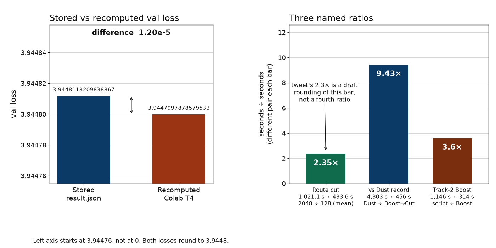

# Boost→Cut validation-loss recompute

Jason Larkin recomputed the published Boost→Cut checkpoint from the Noise speedrun. He did not retrain.

PNG, for a Slack unfurl:

https://raw.githubusercontent.com/jasonlarkin/boost-cut-check/main/figures/val_loss_and_ratios.png

## What was recomputed

`utils/eval.py` at Noise commit `7749eb125f40f634472fb59bb88022e4d8da429d` scored the release checkpoint `track1_boostcut_final.pt` on a Colab Tesla T4 (torch 2.11.0+cu130). The checkpoint sha256 `499dff9fb4d3fcb4fcc5b6c5475ecf5443295462f572c04ed4312605c5bcbcea` matched on that VM before scoring.

| | |
|---|---|
| Recomputed val loss | 3.9447997878579533 |
| Eval wall time | 92.02 s |
| Stored `result.json` val loss | 3.9448118209838867 |
| Difference (stored minus recomputed) | 1.20e-5 |
| Both round to | 3.9448 |

The T4 skipped native bfloat16 compilation. The loss still matched.

`val.pt` shape (544, 2049), token sha256 `5fdb9242ce8ab83e519ab5dd5cf8d64f4d8a99f6e74c137f4ca0f723da5f7437`. `train.pt` shape (4880, 2049), token sha256 `36ccb57eba6f5474b18acf99edd4a4793187260f7da7cc7053322cce59154bde` (not used by the scorer). 544 rows, batch 16, 34 steps, 1,114,112 predictions.

`utils/prepare_data.py`'s dataset stream deadlocked on that VM (SIGTERM at ~904 s, then SIGKILL after a 180 s stall on a local parquet). The pinned split was rebuilt by calling that file's own `encode_split` on the documented FineWeb `sample-10BT` shard (2,147,292,183 bytes). The hashes matched, so the deadlock did not change the tokens that were scored.

## What was not recomputed

There was no 8×H100 retrain. `ledger/verify.py` reports 111 claims and 0 fail. It checks the draft against stored logs. It does not recompute the loss. The Colab run is the recompute.

## The three ratios

2.3× is not defined in the tweet, the chart, [PR 11](https://github.com/qlabs-eng/noise/pull/11), qlabs.sh/noise, or the Noise README. The chart is 7.6 min vs 72 min (Dust record, val 3.991), the same comparison as 456 s vs 4,303 s. The ratio drawn is 4,303 / 456 ≈ 9.43×.

The boost-cut ledger defines 2.3× as a draft rounding of the route cut: top 128 of 2,048 MLP units, 1,021.1 s / mean of three seeds 433.6 s = 2.35×. The README now says 2.4×. The test-loss gap is 0.006. A third figure, 3.6×, is track-2 Boost versus the speedrun script (1,146 s / 314 s).

The right-hand panel draws those three ratios. The tweet's 2.3× is marked on the 2.35× bar as that draft rounding, not as a fourth measurement. Bar heights are the reported figures: 1,021.1 / 433.6 = 2.35×, 4,303 / 456 = 9.436… printed 9.43×, and 1,146 / 314 = 3.65… printed 3.6×.

## Sources

- https://github.com/qlabs-eng/noise/pull/11
- https://github.com/spicylemonade/boost-cut
- https://x.com/spicey_lemonade/status/2111636408540799141
- https://x.com/industriaalist/status/2109740297274191914

Asked which Cammarata ideas mattered, the author replied: "Strong routes and circuit racing (for boost going first)." That string is not in the clones.

Hashes and both losses: [`results.json`](results.json).
